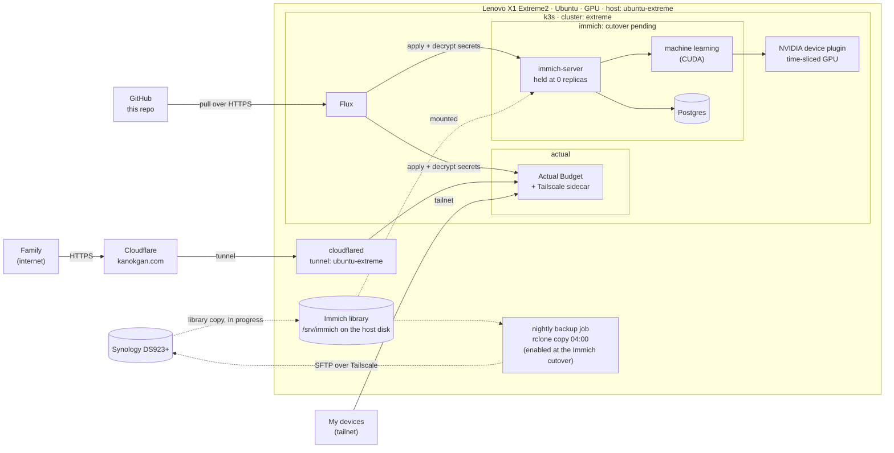
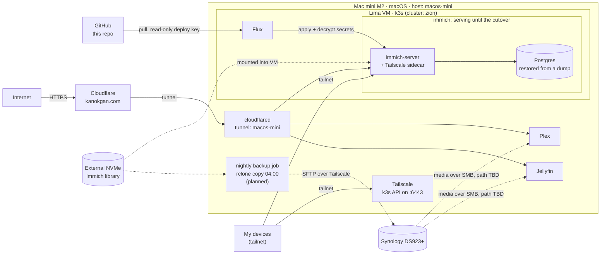

# Zion Lab

My homelab: self-hosted photos (Immich), budgeting (Actual Budget), and media (Plex, Jellyfin), reachable privately over Tailscale and publicly through Cloudflare on `kanokgan.com`. Storage lives on a Synology DS923+.

The setup was rebuilt from an ad hoc cluster into one that is fully defined in Git and reproducible. **This repo is the single source of truth**: both clusters are built only from it, through Flux. The few things that live outside Kubernetes (each machine's host setup, the Lima VM and native media apps on the Mac mini, the Cloudflare connector on each machine, and the one decryption key) are documented here as manual steps.

Current progress: [docs/migration/README.md](docs/migration/README.md). Design decisions: [docs/decisions/](docs/decisions/).

## Why "Zion"?

I love *The Matrix* trilogy, and Zion is my favorite name from it: the last human city, hidden deep underground, where the people who left the Matrix hold out. The word itself comes from Hebrew and is often translated as "stronghold", and in the films it is the last bastion of humanity.

That is what this project is for me. It is the stronghold for my self-hosted life: my photos, my budget, my media, running on hardware I own instead of on someone else's platform. It is also my single place to learn how to run it properly (Kubernetes, networking, backups, operations), and a portfolio that shows the work in the open.

## Architecture

Two machines each run a single-node k3s cluster built from this repo: the Lenovo (cluster `extreme`) and the Mac mini (cluster `zion`, to be renamed `mini`). Clusters are named after the machine, not its role, because roles swap ([ADR 0009](docs/decisions/0009-rebuild-lenovo-in-place.md)). Only one instance of a service is ever writable at once.

State on 2026-10-17: the old Lenovo cluster (`zion-old`) was wiped and rebuilt from this repo. Actual Budget runs on the Lenovo. Immich is still served from the Mac mini until its library finishes copying to the Lenovo and the cutover runs ([runbook](docs/services/immich.md)); afterwards the mini becomes the standby ([ADR 0004](docs/decisions/0004-mini-as-immich-standby.md)).

Legend: solid arrows are requests, dashed arrows are data copies or mounts.

### Lenovo: `extreme` (rebuilt from this repo)

Ubuntu Server stays; k3s is reinstalled from [hosts/ubuntu-extreme/](hosts/ubuntu-extreme/README.md), and Flux applies everything in `clusters/extreme/`. Public traffic comes in through `cloudflared` running on the host, which reaches the apps on NodePorts. The GPU is shared between pods by time-slicing.



### Mac mini: `zion` (serves Immich until the cutover)

A Lima VM runs k3s, and Flux applies everything in `clusters/zion/` from this repo. Secrets are committed encrypted with SOPS + age and decrypted in the cluster. Plex and Jellyfin run as native macOS apps for hardware transcoding ([ADR 0008](docs/decisions/0008-native-media-servers-on-mini.md)). Their setup is documented in [hosts/macos-mini/](hosts/macos-mini/README.md).



### Where this is heading

Immich moves to the Lenovo through the cutover runbook, and `immich.kanokgan.com` is repointed to the Lenovo's tunnel. The mini then becomes the warm standby for Immich ([ADR 0004](docs/decisions/0004-mini-as-immich-standby.md)); Plex and Jellyfin stay native on it. The mini's cluster is renamed `mini` in a safe order described in the [tracker](docs/migration/README.md), and monitoring and the web scraper are rebuilt from Git on both machines.

## Repo map

- `clusters/<cluster>/`: what Flux syncs, including the Flux install itself (`extreme`, and `zion` for the mini until it is renamed)
- `apps/base/<app>/`: cluster-neutral app definitions
- `apps/<cluster>/<app>/`: per-cluster overlays (volumes, Tailscale, encrypted secrets)
- `infrastructure/`: cluster-wide components; today the GPU device plugin for the Lenovo (`base/` and `extreme/`)
- `hosts/<machine>/`: setup for each machine itself, outside Kubernetes. Machines are named `<os>-<nickname>`: `hosts/macos-mini/` (the Lima VM, the native apps, the backup job) and `hosts/ubuntu-extreme/` (k3s install, GPU notes, `cloudflared`, the backup job)
- `docs/decisions/`: architecture decision records
- `docs/services/`: per-service docs with backup and restore runbooks
- `docs/migration/`: migration tracker
- `script/`: a macOS helper that mounts the NAS shares over Tailscale (not part of the cluster)
- `.claude/`: guardrails for AI-assisted work: read-only cluster access, no pushes, no reading secrets

## Repo setup

This repo is public, so every commit is published. Do this once on every machine or fresh clone before committing: Git hooks and `.denylist` are not part of a clone.

1. Install the pre-commit hooks (gitleaks for secrets, plus a check for private terms):
   ```sh
   pip install pre-commit   # or: brew install pre-commit
   pre-commit install
   ```
2. Create `.denylist` in the repo root: private terms that must never be committed (for example family names), one per line, `#` for comments. It is gitignored; keep the master copy in the password manager.
3. For Claude Code: install `jq`. The Bash guard in `.claude/hooks/` blocks every command without it.
4. To edit secrets: install `sops` and `age`, and get the age private key from the password manager ([ADR 0007](docs/decisions/0007-secrets-with-sops-age.md)). Never commit it.

Check that it works:
```sh
pre-commit run --all-files   # both hooks: Passed
```

`git commit --no-verify` and edits in the GitHub web UI skip the hooks. The [secret-scan workflow](.github/workflows/secret-scan.yaml) still scans every push for secrets, but nothing outside your machine checks the private terms in `.denylist`.
