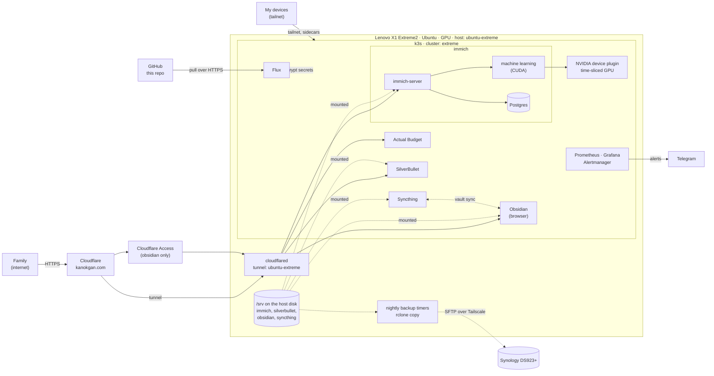
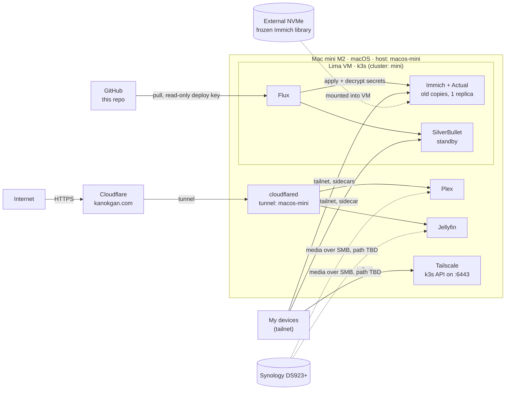

# Zion Lab

My homelab: self-hosted photos (Immich), budgeting (Actual Budget), notes (SilverBullet, Obsidian in the browser, Syncthing), and media (Plex, Jellyfin), reachable privately over Tailscale and publicly through Cloudflare on `kanokgan.com`. Storage lives on a Synology DS923+.

The setup was rebuilt from an ad hoc cluster into one that is fully defined in Git and reproducible. **This repo is the single source of truth**: both clusters are built only from it, through Flux. The few things that live outside Kubernetes (each machine's host setup, the Lima VM and native media apps on the Mac mini, the Cloudflare connector on each machine, and the one decryption key) are documented here as manual steps.

Current progress: [docs/migration/README.md](docs/migration/README.md). Design decisions: [docs/decisions/](docs/decisions/).

## Why "Zion"?

I love *The Matrix* trilogy, and Zion is my favorite name from it: the last human city, hidden deep underground, where the people who left the Matrix hold out. The word itself comes from Hebrew and is often translated as "stronghold", and in the films it is the last bastion of humanity.

That is what this project is for me. It is the stronghold for my self-hosted life: my photos, my budget, my notes, my media, running on hardware I own instead of on someone else's platform. It is also my single place to learn how to run it properly (Kubernetes, networking, backups, operations), and a portfolio that shows the work in the open.

## Architecture

Two machines each run a single-node k3s cluster built from this repo: the Lenovo (cluster `extreme`, production) and the Mac mini (cluster `mini`). Clusters are named after the machine, not its role, because roles swap ([ADR 0009](docs/decisions/0009-rebuild-lenovo-in-place.md)). Only one instance of a service is ever writable at once.

| Service | Production | Mac mini |
|---|---|---|
| Immich | `extreme` ([doc](docs/services/immich.md)) | old frozen copy, tailnet only, no uploads |
| Actual Budget | `extreme` ([doc](docs/services/actual.md)) | old stale copy, tailnet only |
| SilverBullet | `extreme` ([doc](docs/services/silverbullet.md)) | tailnet-only warm standby |
| Obsidian (browser) | `extreme`, behind Cloudflare Access ([doc](docs/services/obsidian.md)) | none |
| Syncthing | `extreme`, tailnet only ([doc](docs/services/syncthing.md)) | none |
| Monitoring | `extreme` ([doc](docs/services/monitoring.md), [ADR 0010](docs/decisions/0010-monitoring.md)) | not started |
| Plex, Jellyfin | native macOS apps on the mini ([ADR 0008](docs/decisions/0008-native-media-servers-on-mini.md)) | same |

History: the old Lenovo cluster (`zion-old`) was wiped on 2026-10-17 and rebuilt from this repo; Immich and Actual spent a few days on the mini and returned to the Lenovo by 2026-10-21. The mini is meant to become a warm standby for Immich ([ADR 0004](docs/decisions/0004-mini-as-immich-standby.md)), but has no refresh procedure yet.

Legend: solid arrows are requests, dashed arrows are data copies or mounts.

### Lenovo: `extreme` (production)

Ubuntu Server stays; k3s is installed from [hosts/ubuntu-extreme/](hosts/ubuntu-extreme/README.md), and Flux applies everything in `clusters/extreme/`. Public traffic comes in through `cloudflared` running on the host, which reaches the apps on NodePorts. The GPU is shared between pods by time-slicing. Two systemd timers copy Immich (04:00) and SilverBullet (04:30) to the NAS.



### Mac mini: `mini` (old copies, standby in waiting, media servers)

A Lima VM runs k3s, and Flux applies everything in `clusters/mini/` from this repo. Secrets are committed encrypted with SOPS + age and decrypted in the cluster. Plex and Jellyfin run as native macOS apps for hardware transcoding ([ADR 0008](docs/decisions/0008-native-media-servers-on-mini.md)). Their setup is documented in [hosts/macos-mini/](hosts/macos-mini/README.md). No backup job runs on the mini: the nightly NAS path is written by the Lenovo only.



### Where this is heading

The mini becomes the warm standby for Immich once it has a tested refresh procedure (NAS to NVMe, then a database restore, after upgrading it to the Lenovo's Immich version). Monitoring is extended to the mini, and the Lenovo's storage grows with a second NVMe ([storage plan](hosts/ubuntu-extreme/README.md)). The open list is in the [tracker](docs/migration/README.md).

## Repo map

- `clusters/<cluster>/`: what Flux syncs, including the Flux install itself (`extreme` and `mini`)
- `apps/base/<app>/`: cluster-neutral app definitions (Immich, Actual, SilverBullet, Obsidian, Syncthing)
- `apps/<cluster>/<app>/`: per-cluster overlays (volumes, Tailscale, NodePorts, encrypted secrets)
- `infrastructure/`: cluster-wide components for the Lenovo: the GPU device plugin and monitoring (`base/`, `extreme/`, `extreme/monitoring/`)
- `hosts/<machine>/`: setup for each machine itself, outside Kubernetes. Machines are named `<os>-<nickname>`: `hosts/macos-mini/` (the Lima VM, the native apps) and `hosts/ubuntu-extreme/` (k3s install, GPU notes, `cloudflared`, the NAS backup jobs)
- `docs/decisions/`: architecture decision records
- `docs/services/`: per-service docs with backup and restore
- `docs/runbooks/`: procedures for recurring operations
- `docs/migration/`: migration tracker
- `script/`: a macOS helper that mounts the NAS shares over Tailscale, and the private-terms check (not part of the cluster)
- `.claude/`: guardrails for AI-assisted work: read-only cluster access, no pushes, no reading secrets

## Repo setup

This repo is public, so every commit is published. Do this once on every machine or fresh clone before committing: Git hooks and `.denylist` are not part of a clone.

1. Install the pre-commit hooks (gitleaks for secrets, plus a check for private terms):
   ```sh
   pip install pre-commit   # or: brew install pre-commit
   pre-commit install
   ```
2. Create `.denylist` in the repo root: private terms that must never be committed (for example family names), one per line, `#` for comments. It is gitignored; keep the master copy in the password manager.
3. For Claude Code: install `jq`. The Bash guard in `.claude/hooks/` blocks every command without it.
4. To edit secrets: install `sops` and `age`, and get the age private key from the password manager ([ADR 0007](docs/decisions/0007-secrets-with-sops-age.md)). Never commit it.

Check that it works:
```sh
pre-commit run --all-files   # both hooks: Passed
```

Before committing manifest changes, render them: `kustomize build apps/extreme` and `kustomize build apps/mini` (also `infrastructure/extreme` and `infrastructure/extreme/monitoring`).

`git commit --no-verify` and edits in the GitHub web UI skip the hooks. The [secret-scan workflow](.github/workflows/secret-scan.yaml) still scans every push for secrets, but nothing outside your machine checks the private terms in `.denylist`.
