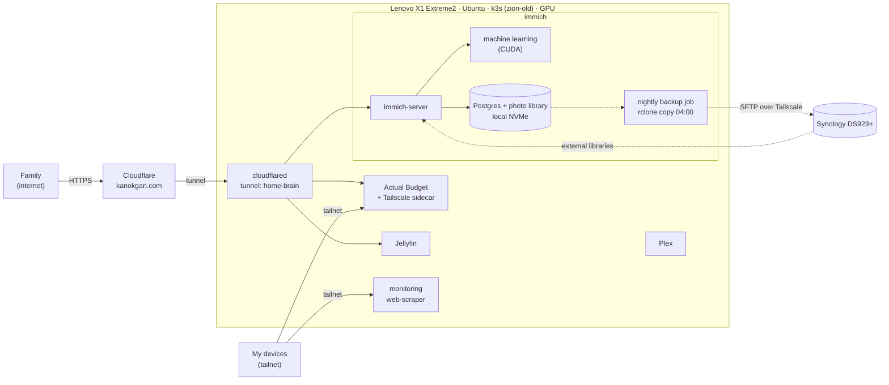
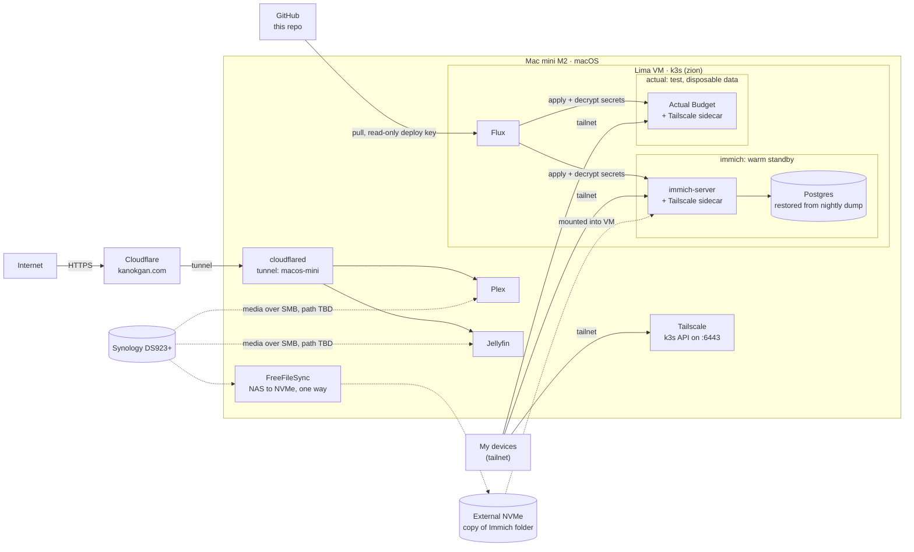

# Zion Lab

My homelab: self-hosted photos (Immich), budgeting (Actual Budget), and media (Plex, Jellyfin), reachable privately over Tailscale and publicly through Cloudflare on `kanokgan.com`. Storage lives on a Synology DS923+.

The setup is being rebuilt from an ad hoc cluster into one that is fully defined in Git and reproducible. **This repo is the single source of truth**: the new cluster is built only from it, through Flux. The few things that live outside Kubernetes (the Lima VM, the native media apps, the Cloudflare connector on the Mac mini, and the one decryption key) are documented here as manual steps.

Current progress: [docs/migration/README.md](docs/migration/README.md). Design decisions: [docs/decisions/](docs/decisions/).

## Why "Zion"?

I love *The Matrix* trilogy, and Zion is my favorite name from it: the last human city, hidden deep underground, where the people who left the Matrix hold out. The word itself comes from Hebrew and is often translated as "stronghold", and in the films it is the last bastion of humanity.

That is what this project is for me. It is the stronghold for my self-hosted life: my photos, my budget, my media, running on hardware I own instead of on someone else's platform. It is also my single place to learn how to run it properly (Kubernetes, networking, backups, operations), and a portfolio that shows the work in the open.

## Architecture

During the migration two hosts run side by side ([ADR 0002](docs/decisions/0002-parallel-cluster-migration.md)). The old cluster keeps serving production while services move to the new one, one at a time. Only one instance of a service is ever writable at once.

Legend: solid arrows are requests, dashed arrows are data copies or mounts.

### Today: `zion-old` on the Lenovo (production)

The original cluster. It serves family today, but it grew by hand and can't be rebuilt from Git, which is why it's being replaced.



### New: `zion` on the Mac mini (built from this repo)

A Lima VM runs k3s, and Flux applies everything in `clusters/zion/` from this repo. Secrets are committed encrypted with SOPS + age and decrypted in the cluster. Services here use Tailscale test addresses and disposable data until each one is cut over.

Plex and Jellyfin run as native macOS apps for hardware transcoding ([ADR 0008](docs/decisions/0008-native-media-servers-on-mini.md)). Their setup is documented in [hosts/macos-mini/](hosts/macos-mini/README.md).



### Where this is heading

Actual Budget and Immich are cut over to `zion` one at a time, and their hostnames are repointed there. Plex and Jellyfin stay native on the Mac mini. Once nothing depends on the Lenovo, it is wiped and rebuilt from this repo as the new `zion`, and the Kubernetes services move onto it through a restore from backup, which also tests that the repo can rebuild the cluster ([ADR 0002](docs/decisions/0002-parallel-cluster-migration.md)). The Mac mini's cluster becomes `zion-standby`, a warm standby that can take over Immich if the Lenovo goes down ([ADR 0004](docs/decisions/0004-mini-as-immich-standby.md)).

## Repo map

- `clusters/zion/`: what Flux syncs, including the Flux install itself
- `apps/base/<app>/`: cluster-neutral app definitions
- `apps/zion/<app>/`: per-cluster overlays (volumes, Tailscale, encrypted secrets)
- `infrastructure/`: cluster-wide components (storage, ingress, monitoring); empty until those ADRs are decided
- `hosts/<machine>/`: setup for each machine itself, outside Kubernetes. Machines are named `<os>-<nickname>`; today only `hosts/macos-mini/`, outside Kubernetes: the Lima VM definition and the native apps
- `docs/decisions/`: architecture decision records
- `docs/services/`: per-service docs with backup and restore runbooks
- `docs/migration/`: migration tracker
- `script/`: a macOS helper that mounts the NAS shares over Tailscale (not part of the cluster)
- `.claude/`: guardrails for AI-assisted work: read-only cluster access, no pushes, no reading secrets

## Repo setup

This repo is public, so every commit is published. Do this once on every machine or fresh clone before committing: Git hooks and `.denylist` are not part of a clone.

1. Install the pre-commit hooks (gitleaks for secrets, plus a check for private terms):
   ```sh
   pip install pre-commit   # or: brew install pre-commit
   pre-commit install
   ```
2. Create `.denylist` in the repo root: private terms that must never be committed (for example family names), one per line, `#` for comments. It is gitignored; keep the master copy in the password manager.
3. For Claude Code: install `jq`. The Bash guard in `.claude/hooks/` blocks every command without it.
4. To edit secrets: install `sops` and `age`, and get the age private key from the password manager ([ADR 0007](docs/decisions/0007-secrets-with-sops-age.md)). Never commit it.

Check that it works:
```sh
pre-commit run --all-files   # both hooks: Passed
```

`git commit --no-verify` and edits in the GitHub web UI skip the hooks. The [secret-scan workflow](.github/workflows/secret-scan.yaml) still scans every push for secrets, but nothing outside your machine checks the private terms in `.denylist`.